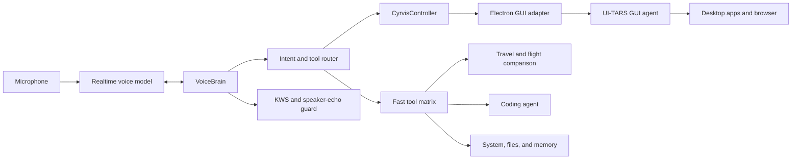

<div align="center">
  
  <h1>CYRVIS</h1>
  <p><strong>A voice-first desktop agent.</strong><br />Say it. It listens, sees, and acts.</p>

  <p>
    <a href="./README.zh-CN.md">简体中文</a> ·
    <a href="./README.cyrvis.md">Technical overview (中文)</a> ·
    <a href="./doc/README.md">Documentation</a>
  </p>

  <p>
    
    
    
    
  </p>
</div>

> **CYRVIS is an independent project.** It is built on the open-source
> [UI-TARS Desktop](https://github.com/bytedance/UI-TARS-desktop) runtime, but it is
> **not** an official ByteDance or UI-TARS product. The upstream README is preserved at
> [README.upstream.md](./README.upstream.md).


## What is CYRVIS?

CYRVIS turns your desktop into a conversational workspace. Instead of typing a prompt
into a chat box and copying the answer somewhere else, you speak to a companion that can
**see the screen, operate apps, write code, compare real-world options, and verify the
result**.

It is not a voice wrapper around a chatbot. A realtime voice model, a GUI agent, a coding
agent, and deterministic tools share one task state and one context.

> Ask for an outcome, not a sequence of clicks.

## Highlights

- **Real-time conversation** — speak naturally and hear a response without waiting for a
  full ASR → LLM → TTS round trip.
- **Interruptible by design** — say “停” / “停一下” to stop speech immediately. A local
  keyword model and speaker-echo guard keep the assistant from interrupting itself.
- **Desktop control** — CYRVIS sees the screen and can move the mouse, type, open apps,
  and navigate the browser through the UI-TARS GUI agent.
- **A coding agent with a workspace** — creates and edits files, runs Python/Node tests,
  opens the result in VS Code, and can run visual scripts such as turtle animations.
- **Live travel comparison** — understands “compare flights, then book the cheapest”,
  queries Google Flights plus Ctrip/Trip.com, compares total prices, and opens the best
  result.
- **Companion context** — system state, recent files, gaze-aware suggestions, proactive
  nudges, and long-term memory are available as experimental modules.
- **Runs locally** — the Electron app, microphone capture, echo guard, and task runtime
  run on your machine. You choose the model providers and keep the keys.

## See it in action

| You say                                                 | CYRVIS does                                                                                                             |
| ------------------------------------------------------- | ----------------------------------------------------------------------------------------------------------------------- |
| “帮我看一下这个报错，直接修掉”                          | Reads the visible editor, plans the fix, edits the file, and runs the relevant test.                                    |
| “香港到三亚，下周五，比一下机票”                        | Runs a ticket-first flight comparison across Google Flights, Ctrip, and Trip.com, then opens the cheapest booking page. |
| “在桌面创建 heart.py，用 turtle 画一个红色爱心，慢慢画” | Writes the file, opens it in VS Code, and launches the turtle window so you can watch the drawing.                      |
| “停” / “停一下”                                         | Stops the current speech immediately; an explicit stop also cancels the running task.                                   |
| “我刚才那个文件放哪了？”                                | Uses task and system context to answer with the recent file path.                                                       |

## How it works



The core loop is:

```text
Voice Agent (Qwen Realtime)
        ↕
     VoiceBrain
        ↕
  CyrvisController
        ↕
 Electron GUI Adapter
        ↕
  UI-TARS GUIAgent
```

`VoiceBrain` decides whether a turn is conversation, a desktop task, a coding task, or a
deterministic tool call. `CyrvisController` owns the single-task state machine. Fast tools
handle things that should not be left to a vision model, such as flight-price comparison
and file operations.

## Quick start

### Requirements

- Node.js **22+**
- pnpm **9.10+**
- macOS 13+ or Windows 10/11
- A working microphone
- API keys for a realtime voice model and a vision-language model
- Optional: Python 3.10+ for the live flight worker

### Install

```bash
git clone https://github.com/rain2create/Cyrvis.git
cd Cyrvis
PUPPETEER_SKIP_DOWNLOAD=1 pnpm install
```

`PUPPETEER_SKIP_DOWNLOAD=1` avoids downloading a bundled Chromium; the browser operator
uses your system Chrome/Edge.

### Configure

```bash
cp apps/ui-tars/.env.example apps/ui-tars/.env
```

Edit `apps/ui-tars/.env` and provide at least:

```env
QWEN_API_KEY=<your-realtime-key>
QWEN_MODEL=<realtime-model-id>
QWEN_REALTIME_URL=<realtime-websocket-url>

CONVERSATION_BASE_URL=<openai-compatible-chat-endpoint>
CONVERSATION_MODEL_NAME=<chat-model-id>

VLM_PROVIDER=<vision-provider-name>
VLM_BASE_URL=<vision-api-endpoint>
VLM_MODEL_NAME=<vision-model-id>
VLM_API_KEY=<vision-api-key>
```

The exact model IDs depend on your provider. See
[apps/ui-tars/.env.example](./apps/ui-tars/.env.example) and
[doc/development.md](./doc/development.md) for the provider-specific setup, including
Volcengine Ark, Qwen Realtime, and the coding agent.

> Never commit `.env` or logs. They are ignored by git for a reason.

### Run

```bash
pnpm run dev:ui-tars
```

On macOS you can also double-click [`start-cyrvis.command`](./start-cyrvis.command).
On Windows, use `scripts/cyrvis/start-dev.cmd`.

On first launch:

1. Grant microphone, screen-recording, and accessibility permissions.
2. Configure the GUI vision model in Settings.
3. Pick a physical microphone and an output device (headset or MacBook speakers).

## What works today

| Area                                             | Status       |
| ------------------------------------------------ | ------------ |
| Realtime voice conversation and barge-in         | Working      |
| Desktop GUI tasks through UI-TARS                | Working      |
| Coding agent: workspace, VS Code, visual scripts | Working      |
| Live flight comparison across three sources      | Working      |
| macOS speaker/headset routing                    | Working      |
| Gaze, proactivity, and long-term memory          | Experimental |
| Linux desktop                                    | Not yet      |

CYRVIS is under active development. Model endpoints, audio devices, and OS permissions
are the usual sources of sharp edges; the [findings](./doc/findings.md) document records
what we have already debugged.

## Repository map

```text
apps/ui-tars/src/main/cyrvis/        VoiceBrain, controller, tools, travel, coding
apps/ui-tars/src/main/cyrvis/voice/  Realtime voice providers
apps/ui-tars/resources/cyrvis/       Coding, flight, and browser workers
doc/                                 CYRVIS architecture and operations docs
design/                              Brand, UI, and companion assets
scripts/cyrvis/                      Launch and development helpers
```

## Documentation

| Document                                                 | What it covers                                             |
| -------------------------------------------------------- | ---------------------------------------------------------- |
| [README.cyrvis.md](./README.cyrvis.md)                   | Detailed Chinese technical overview                        |
| [doc/README.md](./doc/README.md)                         | Documentation index and code map                           |
| [doc/architecture.md](./doc/architecture.md)             | Layers, state machine, and interfaces                      |
| [doc/voice-architecture.md](./doc/voice-architecture.md) | Microphone/playback processes, barge-in, and echo handling |
| [doc/fast-tool-matrix.md](./doc/fast-tool-matrix.md)     | Fast tools, routing, safety, and MCP                       |
| [doc/development.md](./doc/development.md)               | Environment, keys, tests, logs, and troubleshooting        |
| [doc/roadmap.md](./doc/roadmap.md)                       | GUI acceleration, MCP, gaze, proactivity, and memory       |
| [doc/progress.md](./doc/progress.md)                     | What has been built, in chronological order                |

## Built on UI-TARS, maintained as CYRVIS

UI-TARS Desktop provides the GUI-agent runtime and vision-model integration. CYRVIS adds
the realtime voice brain, controller, companion layer, coding and travel tools, and macOS
polish.

- Upstream project: [bytedance/UI-TARS-desktop](https://github.com/bytedance/UI-TARS-desktop)
- Upstream README: [README.upstream.md](./README.upstream.md)
- CYRVIS is independent and is **not affiliated with or endorsed by ByteDance**.
- The upstream license and copyright notices are preserved.

## Contributing

Issues and pull requests are welcome. Read [CONTRIBUTING.md](./CONTRIBUTING.md) before
opening a PR, and never include API keys, logs, or personal paths in an issue.

If CYRVIS is useful to you, a star helps others find it.

## License

Apache License 2.0. See [LICENSE](./LICENSE).
