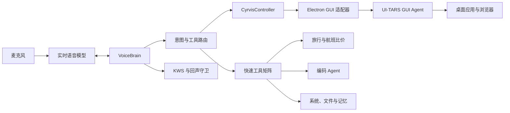

<div align="center">
  
  <h1>CYRVIS</h1>
  <p><strong>语音优先的桌面 Agent。</strong><br />说一句，它听懂、看见，并动手。</p>

  <p>
    <a href="./README.md">English</a> ·
    <a href="./README.cyrvis.md">技术概览</a> ·
    <a href="./doc/README.md">文档</a>
  </p>

  <p>
    
    
    
    
  </p>
</div>

> **CYRVIS 是一个独立项目。** 它构建在开源的
> [UI-TARS Desktop](https://github.com/bytedance/UI-TARS-desktop) 运行时之上，但
> **不是** ByteDance / UI-TARS 的官方产品。上游 README 保留在
> [README.upstream.zh-CN.md](./README.upstream.zh-CN.md)。


## CYRVIS 是什么？

CYRVIS 把桌面变成一个可以对话的工作空间。你不需要把问题打进聊天框、再把答案复制到
别处，而是直接对一个能**看见屏幕、操作软件、写代码、查真实世界信息并验证结果**的
桌面伙伴说话。

它不是给聊天机器人套一层语音：实时语音模型、GUI Agent、编码 Agent 和确定性工具共享
同一份任务状态与上下文。

> 说出你想要的结果，而不是一步步点击的过程。

## 核心能力

- **实时语音**：自然说话、即时回应，不等待完整的 ASR → LLM → TTS 级联。
- **随时打断**：说“停 / 停一下”立即停止播报；本地 KWS 与回声过滤避免助手被自己的
  声音打断。
- **操作桌面**：通过 UI-TARS GUI Agent 看屏幕、移动鼠标、输入文字、打开应用和操作
  浏览器。
- **编码 Agent**：在工作区创建/修改文件，运行 Python/Node 测试，完成后在 VS Code
  打开结果；turtle 等图形脚本可以直接运行并展示绘制过程。
- **真实比价**：理解“先比价，再订最便宜的”，查询 Google Flights + 携程 +
  Trip.com，按总价比较并打开最优结果。
- **主动陪伴**：系统状态、最近文件、注视建议、主动提醒与长期记忆，作为实验性模块
  提供。
- **本地运行**：Electron 应用、麦克风采集、回声守卫和任务运行时都在本机；模型
  Provider 与 Key 由你选择。

## 它能做什么

<p align="center">
  
</p>
<p align="center"><sub><strong>编码 Agent 演示</strong> — CYRVIS 写入 <code>heart.py</code> 并运行 turtle 动画。无声，7.5 秒循环。</sub></p>

| 你说                                                    | CYRVIS 会做                                                                |
| ------------------------------------------------------- | -------------------------------------------------------------------------- |
| “帮我看一下这个报错，直接修掉”                          | 读取当前编辑器内容，规划修复，修改文件并运行相关测试。                     |
| “香港到三亚，下周五，比一下机票”                        | 按机票意图触发 Google Flights、携程、Trip.com 三站比价，打开最便宜的一页。 |
| “在桌面创建 heart.py，用 turtle 画一个红色爱心，慢慢画” | 写入文件，在 VS Code 打开，并运行 turtle 窗口让你看到绘制过程。            |
| “停” / “停一下”                                         | 立刻停止当前播报；明确的停止指令也会取消正在运行的任务。                   |
| “我刚才那个文件放哪了？”                                | 结合任务与系统上下文，给出最近文件路径。                                   |

## 工作方式



核心链路：

```text
Voice Agent（Qwen Realtime）
        ↕
     VoiceBrain
        ↕
  CyrvisController
        ↕
 Electron GUI Adapter
        ↕
  UI-TARS GUIAgent
```

`VoiceBrain` 判断一轮对话是聊天、桌面任务、编码任务还是确定性工具调用；
`CyrvisController` 负责单任务状态机；航班比价、文件操作等不适合交给视觉模型猜的
事情，由快速工具直接完成。

## 快速开始

### 环境要求

- Node.js **22+**
- pnpm **9.10+**
- macOS 13+ 或 Windows 10/11
- 可用的麦克风
- 实时语音模型与视觉语言模型的 API Key
- 可选：Python 3.10+，用于实时航班 Worker

### 安装

```bash
git clone https://github.com/rain2create/Cyrvis.git
cd Cyrvis
PUPPETEER_SKIP_DOWNLOAD=1 pnpm install
```

`PUPPETEER_SKIP_DOWNLOAD=1` 避免下载自带的 Chromium；浏览器操作使用系统
Chrome/Edge。

### 配置

```bash
cp apps/ui-tars/.env.example apps/ui-tars/.env
```

编辑 `apps/ui-tars/.env`，至少填写：

```env
QWEN_API_KEY=<你的实时语音 Key>
QWEN_MODEL=<实时语音模型 ID>
QWEN_REALTIME_URL=<实时语音 WebSocket 地址>

CONVERSATION_BASE_URL=<OpenAI 兼容对话接口>
CONVERSATION_MODEL_NAME=<对话模型 ID>

VLM_PROVIDER=<视觉模型 Provider>
VLM_BASE_URL=<视觉模型接口>
VLM_MODEL_NAME=<视觉模型 ID>
VLM_API_KEY=<视觉模型 Key>
```

具体模型 ID 取决于你的 Provider。火山方舟、Qwen Realtime、编码 Agent 的配置见
[apps/ui-tars/.env.example](./apps/ui-tars/.env.example) 与
[doc/development.md](./doc/development.md)。

> 不要提交 `.env` 或日志。它们已被 git 忽略。

### 启动

```bash
pnpm run dev:ui-tars
```

macOS 也可以双击 [`start-cyrvis.command`](./start-cyrvis.command)；Windows 使用
`scripts/cyrvis/start-dev.cmd`。

首次启动：

1. 允许麦克风、屏幕录制与辅助功能权限；
2. 在设置页配置 GUI 视觉模型；
3. 选择物理麦克风与输出设备（耳机或 MacBook 扬声器）。

## 当前状态

| 能力                                  | 状态     |
| ------------------------------------- | -------- |
| 实时语音对话与打断                    | 可用     |
| UI-TARS 桌面 GUI 任务                 | 可用     |
| 编码 Agent：工作区、VS Code、图形脚本 | 可用     |
| 三站实时航班比价                      | 可用     |
| macOS 扬声器/耳机切换                 | 可用     |
| 注视、主动性与长期记忆                | 实验性   |
| Linux 桌面                            | 尚未支持 |

CYRVIS 仍在活跃开发中。模型接口、音频设备和系统权限是常见的踩坑点；
[findings](./doc/findings.md) 记录了已经排查过的问题。

## 仓库结构

```text
apps/ui-tars/src/main/cyrvis/        VoiceBrain、Controller、工具、旅行、编码
apps/ui-tars/src/main/cyrvis/voice/  实时语音 Provider
apps/ui-tars/resources/cyrvis/       编码、航班与浏览器 Worker
doc/                                 CYRVIS 架构与运维文档
design/                              品牌、界面与陪伴角色素材
scripts/cyrvis/                      启动与开发脚本
```

## 文档

| 文档                                                     | 内容                              |
| -------------------------------------------------------- | --------------------------------- |
| [README.cyrvis.md](./README.cyrvis.md)                   | 详细技术概览                      |
| [doc/README.md](./doc/README.md)                         | 文档索引与代码地图                |
| [doc/architecture.md](./doc/architecture.md)             | 分层、状态机与接口                |
| [doc/voice-architecture.md](./doc/voice-architecture.md) | 采集/播放分进程、打断与回声处理   |
| [doc/fast-tool-matrix.md](./doc/fast-tool-matrix.md)     | 快速工具、路由、安全与 MCP        |
| [doc/development.md](./doc/development.md)               | 环境、密钥、测试、日志与故障排查  |
| [doc/roadmap.md](./doc/roadmap.md)                       | GUI 加速、MCP、注视、主动性与记忆 |
| [doc/progress.md](./doc/progress.md)                     | 已完成工作的实时记录              |

## 与 UI-TARS 的关系

UI-TARS Desktop 提供 GUI Agent 运行时与视觉模型接入；CYRVIS 增加了实时语音大脑、
Controller、陪伴层、编码与旅行工具，以及 macOS 体验优化。

- 上游项目：[bytedance/UI-TARS-desktop](https://github.com/bytedance/UI-TARS-desktop)
- 上游 README：[README.upstream.zh-CN.md](./README.upstream.zh-CN.md)
- CYRVIS 是独立项目，**与 ByteDance 无隶属或背书关系**。
- 保留上游 LICENSE 与版权声明。

## 参与贡献

欢迎 Issue 与 Pull Request。提交前请阅读 [CONTRIBUTING.md](./CONTRIBUTING.md)，不要在
Issue 里包含 API Key、日志或个人路径。

如果 CYRVIS 对你有帮助，点一个 Star 能让更多人发现它。

## License

Apache License 2.0，见 [LICENSE](./LICENSE)。
